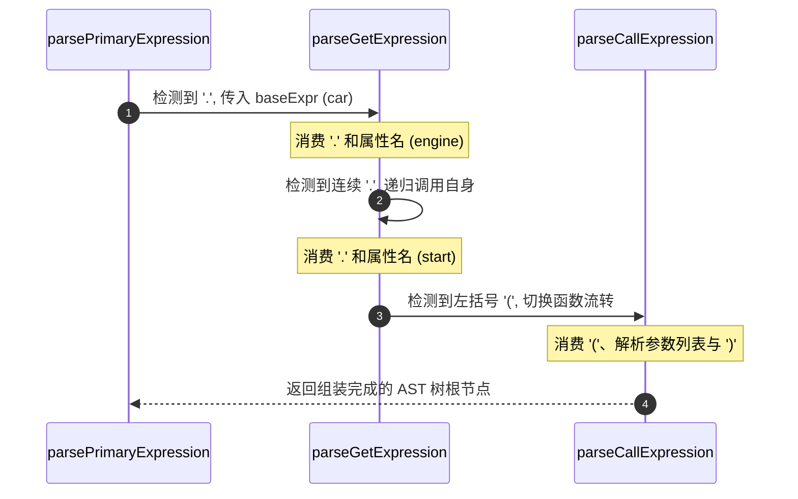

# 解析器如何处理链式调用：点号与括号的递归解析剖析

在编写编程语言或解释器时，链式调用（Chaining）是一个高频出现的语法结构。例如 `car.engine.start(5).status` 这样的代码，其中包含了属性访问、方法调用以及多层嵌套。解析器需要通过严密的逻辑，将这些连续的符号转化为一棵结构清晰的抽象语法树（AST）。本文将深入探讨解析器如何通过纯粹的递归设计驾驭链式调用，并对底层的优化机制进行剖析。

## 一、 基础表达式的识别与入口分发

表达式的起点通常是基础的“原子单元”，例如变量名、字面量或括号表达式。在解析完基础表达式（`baseExpr`）之后，解析器不再通过本地循环去吞没后续的后缀，而是直接进行条件分发，将控制权移交给专门的后缀解析函数。

以下是 `parsePrimaryExpression` 的核心逻辑代码：

```scala
private def parsePrimaryExpression(): Expr =
  val baseExpr = parseAtom()

  if check(TokenType.Dot) then parseGetExpression(baseExpr)
  else if check(TokenType.LeftParen) then parseCallExpression(baseExpr)
  else baseExpr
```

这种设计的精妙之处在于：基础表达式的解析函数本身变得极为纯粹。它只负责识别原子结构，一旦发现后面紧跟点号（`.`）或左括号（`(`），便立刻将当前的表达式作为左值（或对象）传入对应的后缀解析函数中。

## 二、 互递归的设计：`parseGet` 与 `parseCall` 的交织

当控制权进入 `parseGetExpression` 或 `parseCallExpression` 之后，链式调用的无限延展和交替组合完全交由这两个函数之间的“互递归（Mutual Recursion）”来完成。

核心代码实现如下：

```scala
private def parseCallExpression(callee: Expr): Expr =
  val leftParen = advance() // 消耗 '('
  val args = parseArguments() // 解析参数列表
  val rightParen = consume(TokenType.RightParen) // 消耗 ')'

  val callNode = Expr.Call(callee, args, Location(callee.loc.startIncluded, rightParen.pos))

  if check(TokenType.LeftParen) then parseCallExpression(callNode)    // 连续调用
  else if check(TokenType.Dot) then parseGetExpression(callNode)      // 调完接属性
  else callNode

private def parseGetExpression(obj: Expr): Expr =
  advance() // 消耗 '.'
  val name = consume(TokenType.Identifier) // 消耗属性名

  val getNode = Expr.Get(obj, name, Location(obj.loc.startIncluded, name.pos))

  if check(TokenType.LeftParen) then parseCallExpression(getNode)     // 属性被调用
  else if check(TokenType.Dot) then parseGetExpression(getNode)       // 连续属性
  else getNode
```

### 递归解析过程的时序可视化

为了更直观地理解当解析形如 `car.engine.start(5)` 的复杂链式结构时，控制流是如何在两个函数之间交替流转的，可以通过以下时序图进行观察：



### 递归解析步骤说明

以 `car.engine.start(5)` 为例，解析流程如下：

1. **基础识别**：解析器首先通过基础解析识别出变量 `car` 作为表达式起点。

2. **入口分发**：检测到后续跟随 `.`，直接调用 `parseGetExpression(car)`。

3. **属性解析与自循环**：`parseGetExpression` 消费 `.` 和 `engine`，生成 `Get(car, engine)`节点。随后检测到后面依然是 `.`，通过递归调用自身 `parseGetExpression(Get(car, engine))`，继续消费 `start`。

4. **跨函数互递归切换**：当解析完 `start` 的属性节点后，检测到下一个符号是 `(`，函数流转切换至 `parseCallExpression`，传入当前节点并解析参数 `5`，最终生成最外层的 `Call` 节点。

通过这种函数之间的交替委托与递归调用，平铺的词法符号流被剥离并组装成了具有正确嵌套层级的结构。

## 三、 语法树（AST）的层级构建

这种递归设计直接对应了抽象语法树（AST）的层级结构。对于 `a.b.c()` 这样的代码，最终生成的语法树在逻辑上呈现为自底向上的包含关系：

```
CallExpr (arguments: [])
 └── GetExpr (property: "c")
      └── GetExpr (property: "b")
           └── Variable (name: "a")
```

最先书写的标识符 `a` 处于整棵树的最底层，而最后执行的函数调用位于最外层。这种嵌套关系符合语法逻辑，也为后续的语义检查与代码生成奠定了基础。

## 四、 底层研究：递归与 `@tailrec` 字节码优化

在处理极长的链式调用时，频繁的函数递归可能带来栈溢出隐患。为此，代码中通常会引入 `@tailrec` 注解。通过对编译后的字节码及反编译结果（如使用 JADX）的观察，可以明确该注解的实际优化边界。

### 1. `@tailrec` 的作用范围

* **同函数尾递归（已被优化）**：当 `parseCallExpression` 在尾部调用自身（`parseCallExpression(call)`）时，编译器会将其转换为高效的 `while(true)` 循环加变量重赋值。

* **跨函数互递归（未被优化）**：当 `parseCall` 结尾去调用 `parseGet` 时，由于属于两个不同的函数，Scala 的 `@tailrec` 无法进行跨函数的“互递归消除”（Trampolining），这部分仍保留为真正的函数调用。

### 2. 对运行安全性的实际影响

在实际应用中，这种混合模式是安全的：

* **同类操作的优化保证**：真实代码中的超长链式调用通常属于同一种操作的重复（例如连续的属性访问 `a.b.c.d.e`）。对于这类同函数内的自递归，`@tailrec` 已经将其全部转化为循环，因此不会引发栈溢出。

* **交叉嵌套的深度限制**：只有当 `.` 和 `()` 发生频繁交叉混用时，才会触发跨函数的真实递归。在实际工程中，这种交叉嵌套的深度通常维持在个位数，远低于 JVM 的栈深度极限。

## 五、 总结

链式调用的解析体现了编译器前端设计的严谨性。通过将基础表达式的入口分发与后缀解析函数的互递归相结合，解析器能够将平铺的词法符号准确转换为立体的语法结构，同时在底层合理利用编译优化平衡了性能与实现的简洁性。